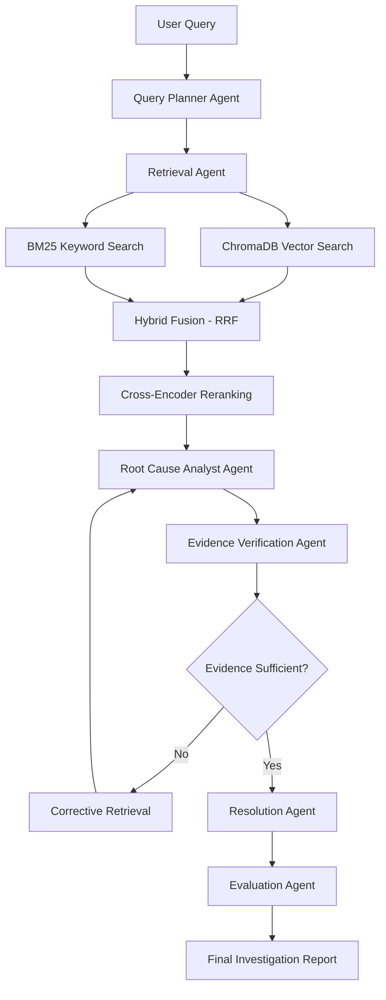
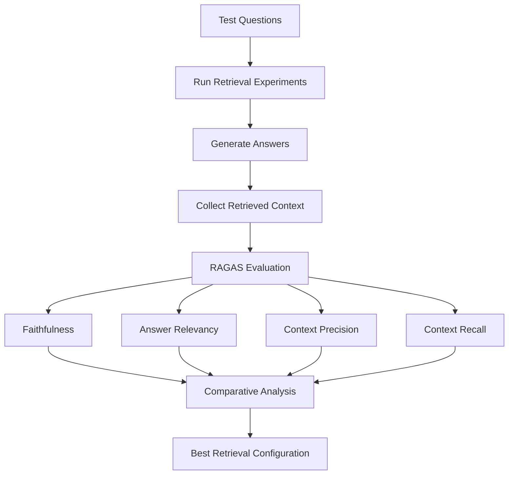

# RootIQ AI — Enterprise Incident Investigation & Root Cause Analysis Using Advanced RAG

<p align="center">

**An Agentic AI-powered incident investigation and root cause analysis platform built using Retrieval-Augmented Generation (RAG), LangGraph, Hybrid Search, and LLM-based evaluation.**

</p>

<p align="center">


</p>

---

## 1. Project Overview

**RootIQ AI** is an AI-powered enterprise incident investigation and root cause analysis platform designed to help engineering and DevOps teams investigate production incidents, identify underlying failures, retrieve relevant historical knowledge, and generate evidence-backed resolution strategies.

Traditional incident investigation often requires engineers to manually examine logs, incident reports, troubleshooting guides, postmortems, and operational documentation. This process can be time-consuming and makes it difficult to connect historical incidents with current system failures.

RootIQ AI addresses this problem through an agentic RAG architecture that combines:

- Multi-agent orchestration using LangGraph.
- Semantic retrieval using vector search.
- Keyword-based retrieval using BM25.
- Hybrid retrieval using Reciprocal Rank Fusion (RRF).
- Cross-encoder reranking for improved relevance.
- LLM-powered root cause analysis through MeshAPI.
- Evidence verification and corrective retrieval.
- Quantitative RAG evaluation using RAGAS.

The platform allows users to upload multiple operational documents and ask natural-language questions about incidents, dependencies, failures, and recovery procedures.

## 2. Problem Statement

Modern software systems generate large amounts of operational information across logs, incident reports, postmortems, and runbooks.

Engineers face several challenges:

1. **Fragmented operational knowledge:** Important incident information is distributed across multiple documents.
2. **Time-consuming investigations:** Finding the root cause requires manually examining logs and historical incidents.
3. **Weak retrieval relevance:** Basic semantic search may fail to retrieve exact error codes, service identifiers, or technical terminology.
4. **Hallucinated explanations:** LLMs may generate conclusions that are not supported by the available evidence.
5. **Inconsistent resolution strategies:** Engineers may overlook previously documented recovery procedures.
6. **Lack of measurable retrieval quality:** Without evaluation, it is difficult to determine whether a more advanced retrieval strategy actually improves answer quality.

RootIQ AI addresses these challenges through an evidence-driven, multi-stage RAG pipeline.

## 3. Key Features

| Feature | Description |
|---|---|
| Multi-document ingestion | Upload PDF, DOCX, TXT, MD, LOG, and CSV documents |
| Intelligent chunking | Recursive text splitting with configurable chunk size and overlap |
| Persistent vector storage | Store document embeddings using ChromaDB |
| Semantic search | Retrieve contextually relevant passages using embeddings |
| BM25 retrieval | Retrieve documents using keyword-based relevance |
| Hybrid retrieval | Combine vector and lexical rankings using RRF |
| Cross-encoder reranking | Reorder retrieved passages based on query-document relevance |
| Agentic investigation | Coordinate planning, retrieval, analysis, verification, and resolution |
| Evidence-backed answers | Generate explanations grounded in retrieved operational documents |
| Corrective retrieval | Retrieve additional evidence when verification identifies gaps |
| RAGAS evaluation | Measure faithfulness, answer relevancy, context precision, and context recall |
| Retrieval benchmarking | Compare four different retrieval configurations |
| Interactive dashboard | Upload documents, investigate incidents, and inspect agent execution |

## 4. System Architecture

The platform follows a multi-stage Agentic RAG architecture.

### High-level workflow



*Note: In vector-only and BM25-only experiments, the corresponding individual retrieval method is used instead of hybrid fusion. Reranking is enabled for the hybrid-with-reranking configuration.*

### Agent Architecture

**1. Query Planner Agent**

- Understands the user's incident investigation question.
- Identifies relevant services, error patterns, and technical concepts.
- Generates multiple focused retrieval queries.
- Improves retrieval coverage for complex questions.

**2. Retrieval Agent**

- Retrieves relevant passages from the indexed knowledge base.
- Supports vector, BM25, and hybrid retrieval.
- Combines multiple retrieval results and removes duplicate evidence.
- Supports optional cross-encoder reranking.

**3. Root Cause Analyst Agent**

- Examines retrieved evidence.
- Identifies potential failure mechanisms.
- Connects symptoms with underlying technical causes.
- Generates an evidence-based incident analysis.

**4. Evidence Verification Agent**

- Checks whether important conclusions are supported by retrieved passages.
- Identifies missing evidence.
- Determines whether additional retrieval is required.

**5. Corrective Retrieval Agent**

- Expands the search using missing evidence identified by the verifier.
- Retrieves additional operational context.
- Sends the expanded evidence back for analysis.

**6. Resolution Agent**

- Generates corrective and preventive recommendations.
- Provides actionable recovery steps.
- Grounds recommendations in retrieved documentation.

**7. Evaluation Agent**

- Produces workflow-level evaluation information.
- Tracks investigation outcomes and verification-related indicators.

The agent workflow is orchestrated using LangGraph.

## 5. Advanced RAG Pipeline

A major component of RootIQ AI is its configurable retrieval architecture.

### A. Document Processing and Indexing

Uploaded documents pass through the following pipeline:

1. Document extraction.
2. Text cleaning and preprocessing.
3. Recursive text chunking.
4. Metadata assignment.
5. Embedding generation.
6. Persistent storage in ChromaDB.
7. Lexical indexing for BM25 retrieval.

**Chunking configuration:**

| Parameter | Configuration |
|---|---|
| Chunk size | 900 characters |
| Chunk overlap | 150 characters |
| Embedding model | `sentence-transformers/all-MiniLM-L6-v2` |
| Vector database | ChromaDB |
| Lexical retrieval | BM25 |

### B. Vector Search

Semantic retrieval converts document chunks and user queries into vector embeddings.

The system uses similarity search to retrieve semantically related passages, even when the query does not contain the exact terminology used in the source documents.

### C. BM25 Keyword Retrieval

BM25 retrieves passages using lexical matching.

It is particularly useful for technical incident investigation involving:

- Error codes.
- Service names.
- Database identifiers.
- Log messages.
- Configuration parameters.
- Exact technical terminology.

### D. Hybrid Retrieval Using Reciprocal Rank Fusion

Hybrid retrieval combines the rankings from vector search and BM25.

The implementation uses weighted Reciprocal Rank Fusion:

\[
RRF(d)=
\frac{0.55}{60+rank_{vector}(d)}
+
\frac{0.45}{60+rank_{BM25}(d)}
\]

The combined ranking helps leverage both semantic understanding and exact keyword matching.

### E. Cross-Encoder Reranking

After retrieving candidate passages, a cross-encoder evaluates query-passage relevance.

**Reranker model:**

`cross-encoder/ms-marco-MiniLM-L-6-v2`

Unlike independent embedding similarity, the cross-encoder evaluates the query and document together, helping improve the ordering of retrieved evidence.

## 6. Comparative Retrieval Experiments

RootIQ AI includes a retrieval benchmarking framework to compare four different RAG configurations.

| Experiment | Retrieval method | Reranking |
|---|---|---|
| A | Vector Search | Disabled |
| B | BM25 | Disabled |
| C | Hybrid Search + RRF | Disabled |
| D | Hybrid Search + RRF | Cross-Encoder Enabled |

### Why compare these configurations?

The experiments investigate:

- Whether semantic retrieval is sufficient for operational questions.
- How keyword retrieval performs on technical identifiers.
- Whether combining semantic and lexical search improves retrieval quality.
- Whether cross-encoder reranking improves the relevance of retrieved evidence.
- How retrieval quality changes against computational latency.

All configurations should use the same indexed documents and test questions.

For a controlled retrieval ablation, use identical query plans across configurations, in addition to keeping the LLM, prompts, and other evaluation conditions consistent.

## 7. RAGAS Evaluation Framework

To evaluate the quality of generated responses, RootIQ AI uses the RAGAS evaluation framework.

Four evaluation metrics are included:

| Metric | What it measures |
|---|---|
| Faithfulness | Whether generated claims are supported by retrieved context |
| Answer Relevancy | Whether the answer addresses the user's question |
| Context Precision | Whether retrieved passages are relevant |
| Context Recall | Whether the retrieved context covers the required reference information |

### Evaluation Workflow



### Evaluation Outputs

The evaluation script generates the following artifacts:

| Output file | Purpose |
|---|---|
| `ragas_question_scores.csv` | Question-level evaluation scores |
| `experiment_performance.csv` | Experiment performance information |
| `experiment_samples.json` | Generated answers and retrieved contexts |
| `ragas_comparison.csv` | Comparative RAGAS metrics |
| `latency_comparison.csv` | Retrieval latency comparison |
| `best_pipeline.json` | Best-performing configuration summary |

**Important:** RAGAS scores must be generated from actual experiment runs. Do not use illustrative or manually assigned values as measured evaluation results.

## 8. Technology Stack

| Category | Technologies |
|---|---|
| Programming Language | Python |
| Backend Framework | FastAPI |
| Frontend | React.js, Vite |
| LLM Gateway | MeshAPI |
| LLM Integration | OpenAI-compatible API |
| Agent Orchestration | LangGraph |
| RAG Framework | LangChain |
| Vector Database | ChromaDB |
| Embedding Model | Sentence Transformers |
| Lexical Retrieval | BM25 |
| Hybrid Search | Reciprocal Rank Fusion |
| Reranking | Cross-Encoder |
| Evaluation | RAGAS |
| Data Processing | Pandas |
| API Communication | REST API |

## 9. Dataset and Knowledge Base

The project uses a synthetic enterprise incident knowledge base created for demonstrating incident investigation and retrieval capabilities.

### Dataset Structure

```text
backend/
└── data/
    ├── documents/
    │   ├── incident_reports/
    │   ├── postmortems/
    │   ├── troubleshooting_guides/
    │   ├── runbooks/
    │   ├── operational_logs/
    │   └── reference/
    │
    ├── chroma/
    └── chunks.json
```

### Incident Scenarios

| Incident | Scenario | Root Cause |
|---|---|---|
| INC-1001 | Checkout API returning HTTP 503 | Database connection exhaustion and payment retry amplification |
| INC-1002 | Payment API latency | Database connection exhaustion |
| INC-1003 | Authentication failures | Expired TLS certificate |
| INC-1004 | Kafka consumer lag | Oversized batches and database timeouts |
| INC-1005 | Redis performance degradation | Cache stampede |
| INC-1006 | Payment API memory growth | Middleware object retention |
| INC-1007 | PostgreSQL disk pressure | Temporary tables and WAL archive delay |
| INC-1008 | Ingress routing failure | Configuration regression |

The dataset includes related postmortems, troubleshooting guides, operational logs, runbooks, and service reference documents.

*Dataset note: The included incident scenarios are synthetic demonstration data, not actual production-company incident records.*

## 10. Project Structure

```text
RootIQAI/
│
├── backend/
│   ├── app/
│   │   ├── main.py
│   │   ├── config.py
│   │   ├── llm.py
│   │   ├── schemas.py
│   │   ├── ingestion.py
│   │   ├── storage.py
│   │   ├── retrieval.py
│   │   └── agents.py
│   │
│   ├── data/
│   │   ├── documents/
│   │   ├── chroma/
│   │   └── chunks.json
│   │
│   ├── evaluation_results/
│   │
│   ├── evaluate_rag_comparison.py
│   ├── requirements.txt
│   └── .env.example
│
├── frontend/
│   ├── src/
│   │   ├── App.jsx
│   │   ├── main.jsx
│   │   └── style.css
│   │
│   ├── package.json
│   └── vite.config.js
│
└── README.md
```

## 11. Installation and Setup

### Prerequisites

- Python 3.11
- Node.js and npm
- MeshAPI API key
- Git

### Step 1: Clone the repository

```bash
git clone https://github.com/YOUR_USERNAME/RootIQAI.git

cd RootIQAI
```

### Step 2: Set up the backend

```bash
cd backend

python -m venv venv
```

Activate the virtual environment.

**Windows PowerShell:**

```powershell
.\venv\Scripts\Activate.ps1
```

Install dependencies:

```bash
pip install -r requirements.txt
```

### Step 3: Configure environment variables

Create a `.env` file inside the backend directory.

```env
MESH_API_KEY=your_meshapi_api_key
MESH_BASE_URL=https://api.meshapi.ai/v1
MESH_MODEL=openai/gpt-4o

DATA_DIR=./data
CHROMA_DIR=./data/chroma

EMBEDDING_MODEL=sentence-transformers/all-MiniLM-L6-v2

TOP_K=8
MAX_RETRIEVAL_RETRIES=1

RERANKER_MODEL=cross-encoder/ms-marco-MiniLM-L-6-v2

CORS_ORIGINS=http://localhost:5173
```

Use the model and API endpoint available in your MeshAPI account. Never commit your actual API key.

### Step 4: Start the backend

From the backend directory:

```bash
python -m uvicorn app.main:app --host 127.0.0.1 --port 8000
```

Backend API:

`http://127.0.0.1:8000`

API documentation:

`http://127.0.0.1:8000/docs`

### Step 5: Set up the frontend

Open another terminal:

```bash
cd frontend

npm install

npm run dev
```

Frontend dashboard:

`http://localhost:5173`

### Step 6: Upload and index documents

1. Open the dashboard.
2. Navigate to the document upload section.
3. Upload operational documents.
4. Wait for document extraction and chunking.
5. Verify that documents have been indexed successfully.

The indexed documents are stored in the persistent ChromaDB vector store and lexical chunk store.

### Step 7: Run comparative evaluation

Keep the backend running.

Open another terminal:

```bash
cd backend

pip install ragas==0.2.15 datasets langchain-openai langchain-huggingface pandas requests

python evaluate_rag_comparison.py
```

The script executes the four retrieval configurations and evaluates generated responses using RAGAS.

## 12. Example Investigation Queries

Try these questions in the dashboard:

**Root Cause Analysis**

```text
Why did checkout-api return HTTP 503 on October 14?
```

**Incident Relationship Investigation**

```text
Are INC-1001 and INC-1002 related?
```

**Cross-Service Failure Analysis**

```text
Explain how payment-api database connection exhaustion affected checkout-api.
```

**Comparative Incident Analysis**

```text
Compare INC-1002 and INC-1006. Explain their different root causes.
```

**Operational Recovery**

```text
Provide a recovery plan for the Kafka consumer backlog.
```

**Infrastructure Investigation**

```text
What caused PostgreSQL disk pressure in INC-1007?
```

**Preventive Recommendations**

```text
How can Redis cache stampede be prevented?
```

## 13. Engineering Challenges and Solutions

| Engineering challenge | Implemented solution |
|---|---|
| Inconsistent retrieval quality | Combined semantic and lexical retrieval |
| Exact technical terminology missed by semantic search | Integrated BM25 keyword search |
| Irrelevant passages appearing near the top | Added cross-encoder reranking |
| Complex questions requiring multiple searches | Implemented query planning |
| Unsupported LLM conclusions | Added evidence verification |
| Missing evidence during investigation | Implemented corrective retrieval |
| Large operational knowledge base | Used chunking and persistent vector storage |
| Difficult-to-measure RAG quality | Integrated RAGAS evaluation |
| Comparing retrieval strategies | Built a four-configuration benchmarking pipeline |

## 14. Future Enhancements

- Add real-time monitoring and incident alert integration.
- Support direct ingestion from observability platforms.
- Introduce structured incident metadata filtering.
- Add user feedback and answer-quality tracking.
- Expand evaluation with repeated experiments and confidence intervals.
- Add domain-specific evaluation datasets.
- Introduce role-based access control for enterprise teams.
- Optimize retrieval latency and embedding inference.

## 15. Business Impact and Use Cases

RootIQ AI is designed to support:

- Site Reliability Engineering (SRE).
- DevOps incident management.
- Production troubleshooting.
- Root cause analysis.
- IT operations management.
- Knowledge-base-assisted technical support.
- Historical incident investigation.

By bringing operational documentation into an evidence-driven conversational interface, the platform aims to reduce manual information discovery and make incident investigation more consistent.

## 16. What Makes This Project Different?

Unlike a basic PDF chatbot that simply retrieves passages and generates an answer, RootIQ AI focuses on the complete incident investigation workflow.

Its distinguishing engineering capabilities include:

1. **Agentic orchestration:** Multiple specialized agents handle planning, retrieval, analysis, verification, and resolution.
2. **Advanced retrieval engineering:** Semantic search, BM25, RRF, and cross-encoder reranking.
3. **Evidence verification:** The system checks whether generated explanations are supported by retrieved documents.
4. **Corrective retrieval:** The workflow can search again when evidence is insufficient.
5. **Quantitative evaluation:** Four retrieval configurations are compared using RAGAS.
6. **Practical application:** The system targets a real engineering problem rather than demonstrating only a generic chatbot.

## 17. Resume Description

**RootIQ AI — Agentic RAG-Based Enterprise Incident Investigation System**

- Engineered an Agentic RAG platform using **LangGraph, LangChain, FastAPI, and MeshAPI** to automate enterprise incident investigation, root cause analysis, and evidence-backed resolution recommendations.
- Implemented an advanced retrieval pipeline combining **ChromaDB vector search, BM25, Reciprocal Rank Fusion (RRF), and Cross-Encoder reranking** to improve technical document retrieval.
- Developed a multi-agent workflow for query planning, evidence retrieval, root cause analysis, verification, and corrective retrieval.
- Built a **RAGAS-based evaluation framework** comparing four retrieval configurations across faithfulness, answer relevancy, context precision, and context recall.

---

## 18. Author

**Piyush Singh**

B.Tech — Computer Science and Engineering (AI & ML)

VIT Bhopal University

- GitHub: [Add your GitHub profile]
- LinkedIn: [Add your LinkedIn profile]

---

<p align="center">

**RootIQ AI — From Operational Documents to Evidence-Driven Incident Intelligence**

</p>
